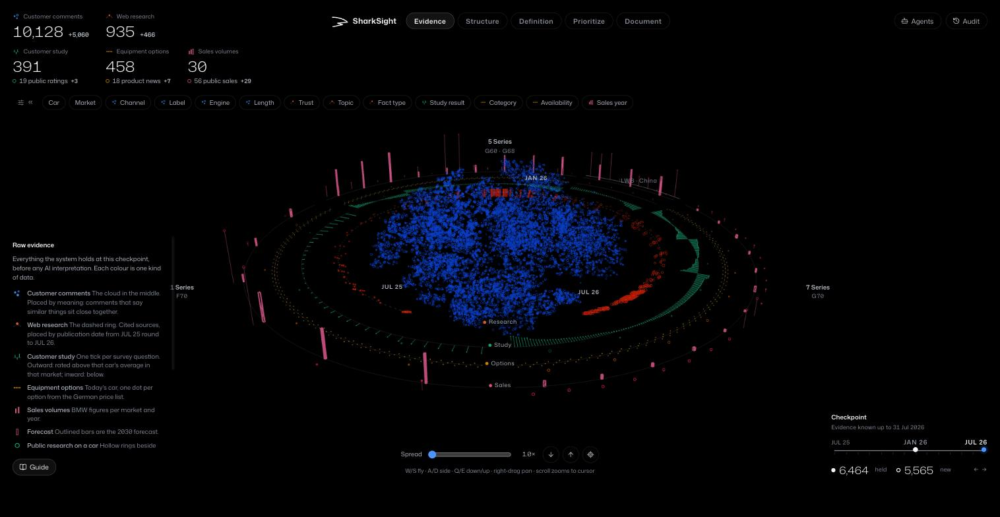
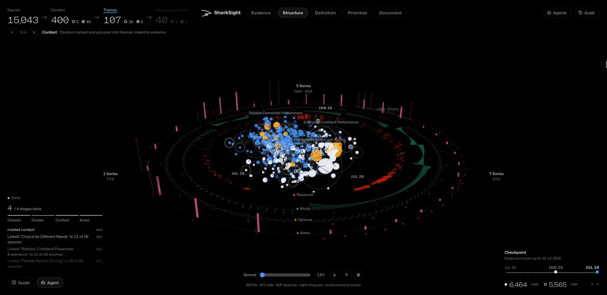
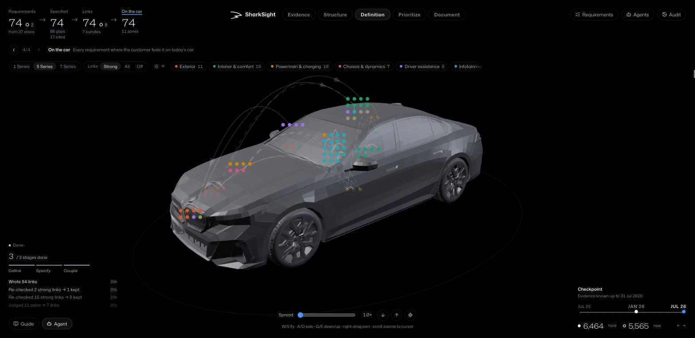
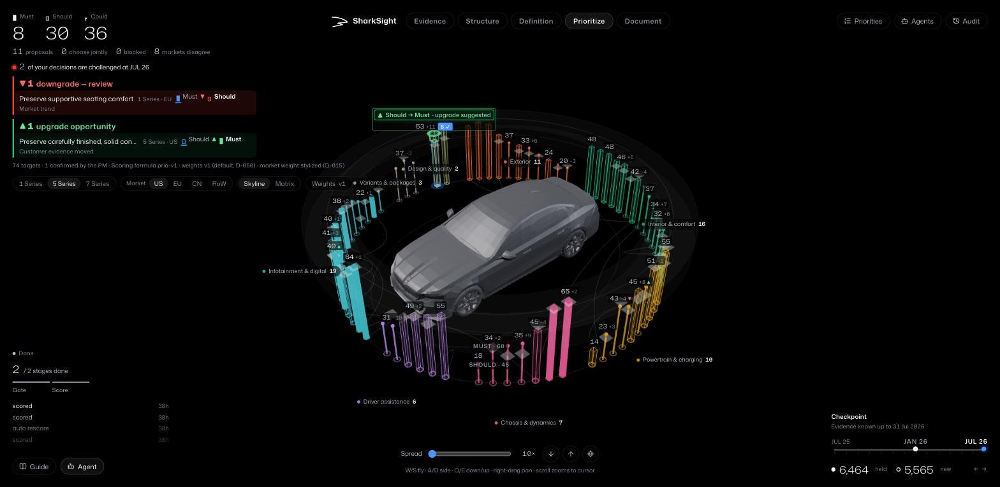
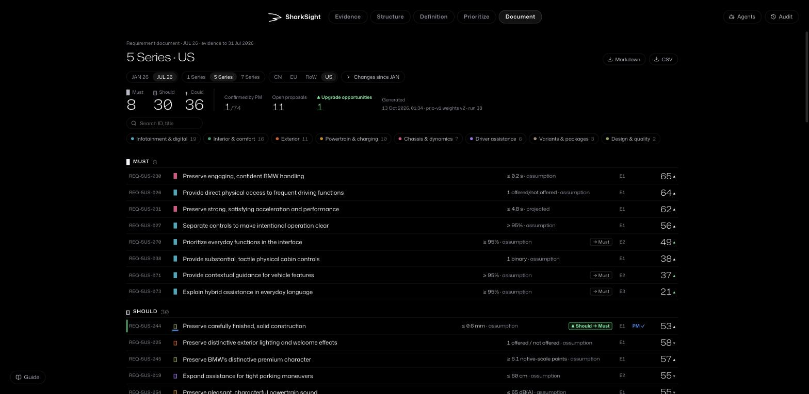
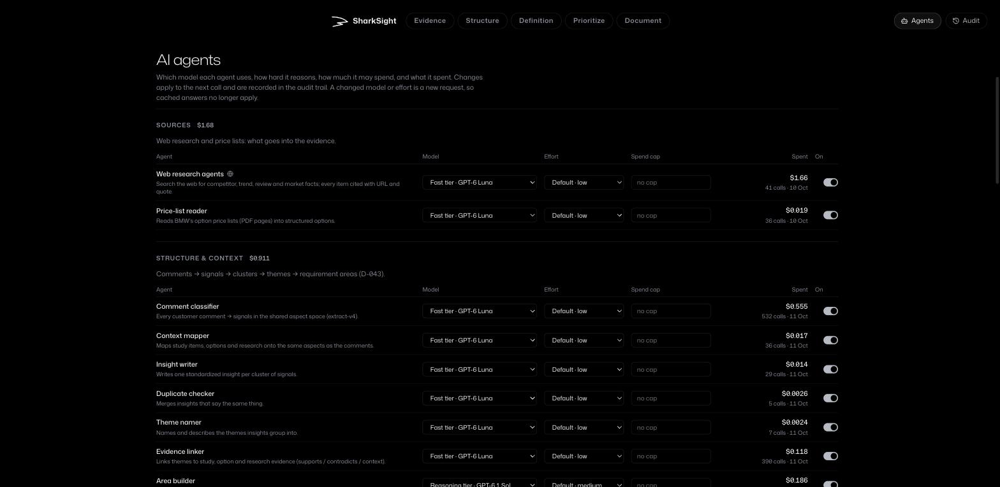
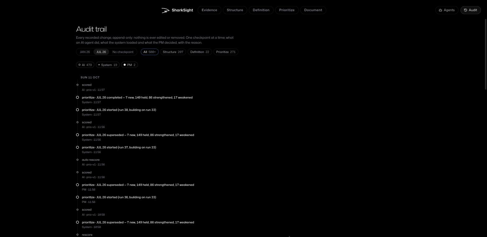

# SharkSight

SharkSight turns what customers say into **prioritized, evidence-linked requirements for the next generation of a
car**: what the successor of the BMW 1, 5 and 7 Series should offer its customers, market by market. The AI reads,
groups, drafts, checks and scores; the **product manager decides**; every step is traceable to the customers' own
words and recorded in an append-only audit trail.

## What it does

SharkSight is a solution to the BMW hackathon challenge **"AI for Product Decision Making"**.

- **One evidence base:** 10,128 customer comments, a customer study, sales figures, option price lists, and about 900
  cited web sources on competitors, trends and markets.
- **Two real-date checkpoints:** JAN 26 and JUL 26. The second builds on the first, so you can see which needs are
  new, which held and which got stronger or weaker.
- **An AI pipeline from evidence to decisions:** comments become signals, signals become clusters and themes, and
  themes become requirement areas. Each area becomes a requirement with a measurable target, linked to related
  requirements, then checked for brand and market fit. Finally it gets a transparent score for every car line and
  market.
- **The PM in the loop:** the AI only proposes. Priorities, targets and approvals are human decisions, each with a
  reason.
- **Built for a real process, not a one-off list:** every score explains itself, markets are treated as different
  customers, and evidence is kept apart from assumptions. OpenAI spend runs under limits set in the app.

Stack: Python (FastAPI) and PostgreSQL with pgvector; React and three.js for the 3D interface; OpenAI models. It is
deployed on Render, with the database on Neon.

## The app, page by page

The five pages follow the PM's work from left to right. A checkpoint switch sits in the bottom right corner (JAN 26 → JUL 26).

### 1 · Evidence

Everything the system knows at a checkpoint, before any AI interpretation, shown as one 3D space:

- **The blue cloud:** the customer comments, placed by meaning, so comments that say similar things sit close together.
- **The rings:** web research by publication date, customer study results, equipment options and sales volumes, with
  a sector for each car line.

The counters at the top show what is new since the last checkpoint, and the filters narrow the view by car, market,
channel, topic and more.

### 2 · Structure

How the AI turns raw comments into structure, step by step:

1. **Classify:** comments become signals.
2. **Cluster:** similar signals are grouped.
3. **Context:** clusters are named and gathered into themes, and each theme is linked to study, option and research
   evidence that supports or contradicts it.
4. **Areas:** themes are grouped into requirement areas.

The funnel at the top counts each step; the live agent panel on the left shows what the AI did.

### 3 · Definition

Every requirement is placed where the customer experiences it on today's car. Each one has a customer-experienced
metric and a target ladder (baseline, threshold, target, stretch). The PM picks the target. Each number is marked as
cited, projected, an assumption or a gap. The arcs link requirements that depend on or strengthen each other.

### 4 · Prioritize

A score for every requirement × car line × market. Its factors are visible: customer, business and future. The
"skyline" around the car shows each requirement as a column grouped by domain, with Must, Should and Could bands.

When new evidence moves a score against a band the PM already confirmed, the AI doesn't change it. It raises an
**upgrade or downgrade proposal** with its cause (top left), and the PM decides. Weights can be adjusted with a live
preview.

### 5 · Document

The deliverable: the requirement list for one car line × market at a checkpoint, grouped by band. Each row shows its
target, evidence level, score and any open proposal, and every requirement traces back to its sources.

"Changes since JAN" shows what moved. The list exports to Markdown or CSV.

### AI agents

Every AI step is an agent with its own model, reasoning effort, spend cap and on/off switch. Spending is shown per
agent, and the spend limits apply to all of them.

### Audit trail

Every change, one checkpoint at a time: what an AI agent did, what the system loaded and what the PM decided, with the
reason. It is append-only, and the database itself refuses edits or deletions.

## For developers

How to run, test and deploy it, the project rules and all decisions are in [`AGENTS.md`](AGENTS.md) and
[`foundation/`](foundation/).
